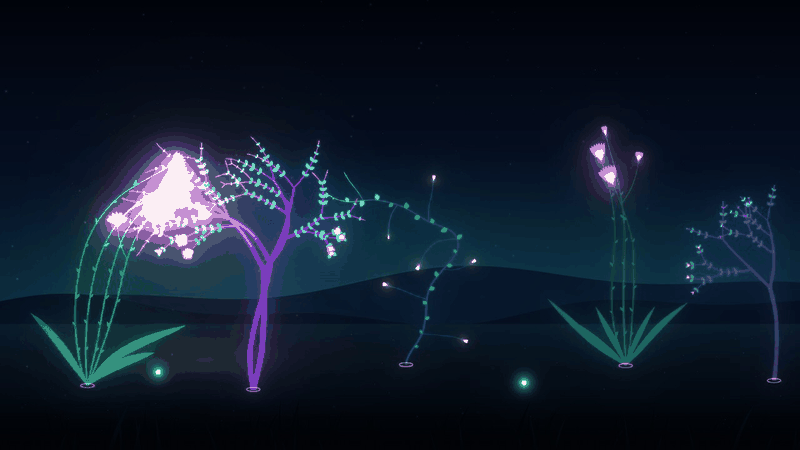
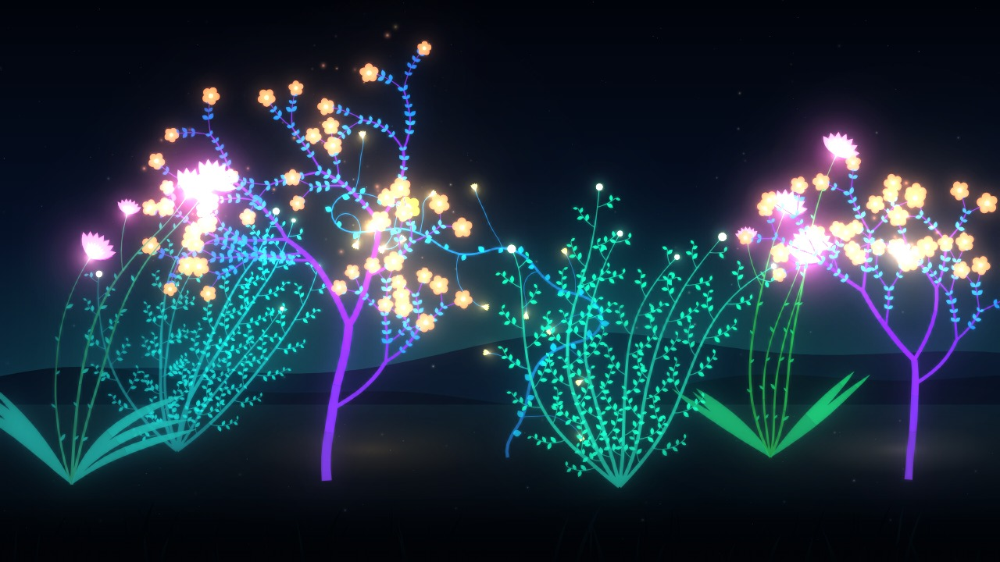

# Noctiflora

A bioluminescent garden that bends, branches and blooms toward the light you move across the screen.



**Live demo: https://jortegadmr.github.io/noctiflora/**



## Features

- **Your cursor (or finger) is a lantern.** Plants lean toward it, grow faster in its glow and open their flowers when lit. Moving the light leaves a fading trail that keeps guiding growth.
- **Starts on its own.** A wandering amber light drifts through the garden until you take over, and seeds are already sprouting when the page loads.
- **Click or tap to sow.** The seed falls from where you click and roots at a depth that matches the height of the click, so the garden gains parallax.
- **Four species with different morphology:** a fern (arching fronds with pinnate leaflets), a lumen tree (forking crown with blossoms), a lily (stalks, blade leaves and large cup flowers) and a vine (sinuous climber with spiralling tendrils).
- **Time-lapse** speeds growth up so you can watch whole plants unfold, **Replant** starts over.
- Responsive, touch friendly, keyboard accessible (arrow keys move the light, Enter sows) and tuned for `prefers-reduced-motion`.
- Canvas 2D only: no WebGL, no runtime dependencies, no network requests.

## How it works

- Each plant is a tree of branches made of short segments. A growing tip steers by blending its heading, a weak upward pull (gravitropism) and the direction of the light field at its position, plus smooth noise and a per-species curl.
- The light field is analytic: the pointer, the drifting lamp and the fading trail points each contribute an inverse-square-like falloff, giving every point an intensity and a direction.
- Branching rules are per species (pinnate fronds, repeated forks, side stalks, tendrils). Radius follows the pipe model, so thickness decreases toward the tips.
- Existing plants keep reacting: every frame the skeleton is recomputed by forward kinematics with a small, spring-smoothed bend per segment toward the light, plus wind sway.
- Glow is a cheap multi-level bloom: the plant layer is downsampled, blurred and added back.

## Stack

TypeScript, Canvas 2D and Vite.

## Run locally

```bash
npm ci
npm run dev      # development server
npm run build    # type-check and production build into dist/
npm run preview  # serve the production build
```

## License

MIT. See [LICENSE](LICENSE).
